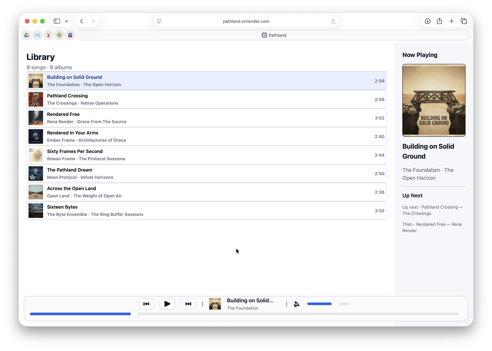
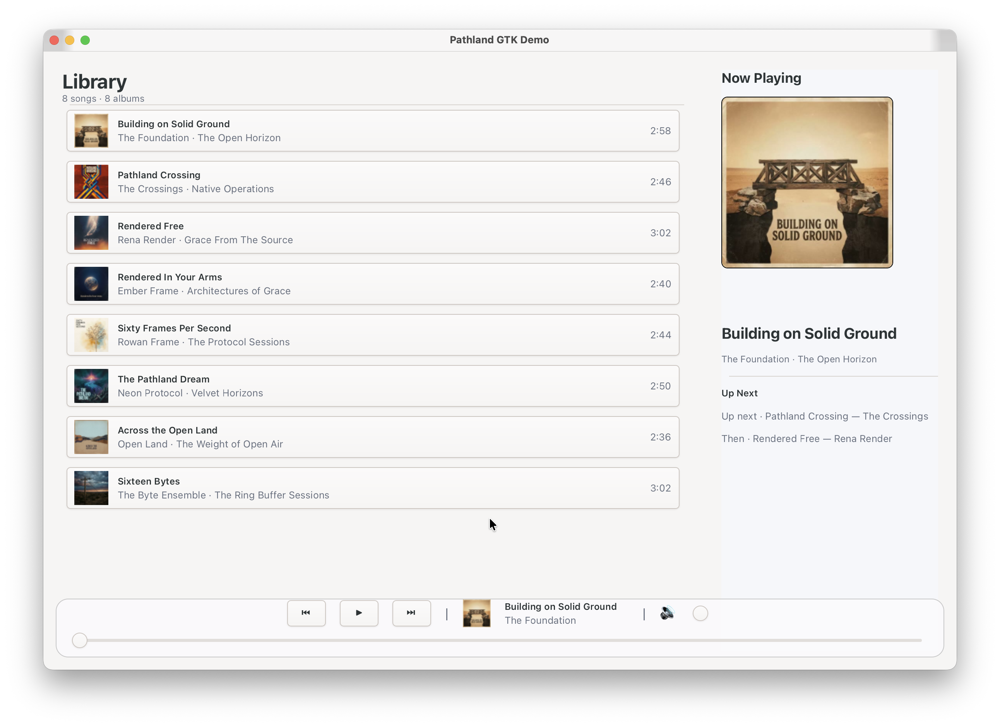

# Pathland

> An open UI protocol. Declarative UI — written once in any language, rendered natively anywhere.

**Status: proof of concept.** It works end to end and the tests are green, but the
wire format and APIs may change before 1.0.

[](https://github.com/PathlandDev/Pathland/actions/workflows/ci.yml)

## Pathland is a protocol

Architecture rationale and trade-offs are recorded in the
[architecture decision records](docs/decisions/README.md); the
[specifications](spec/OPCODE.md) define the current contract.

Pathland is first and foremost a **binary UI protocol** — not just a framework,
and not a single rendering
target. Your view declaration compiles to fixed 16-byte opcodes that any renderer
applies to native elements. The wire is the contract: a view written in Kotlin, Rust,
or any other supported DSL produces the **same opcode stream**, and any renderer can
apply it.

That makes Pathland **language- and renderer-agnostic**:

- **Write the UI once, declaratively.** A SwiftUI-shaped DSL in your language of
  choice — Kotlin, Rust, anything — describes the same view structure, whatever
  it later runs on.
- **Run it on any surface.** The same view code drives today's server-rendered web
  and the native GTK4 desktop renderer, and is on track for the browser via WASM,
  embedded chips (LVGL), and native mobile/desktop (SwiftUI/UIKit, Jetpack Compose,
  Qt) ([Where it's headed](#where-its-headed)).
- **Only changes travel.** The protocol is a stream of tiny binary deltas: an
  unchanged screen transmits zero bytes, and updates are applied in place.

**Server-side rendering is the first surface we ship** — the flagship
getting-started path — **not the whole story**. It's the on-ramp that's useful
today; the protocol underneath is where the portability comes from.

## See it in action

The same shared demo views, rendered by two of Pathland's surfaces — server-side
HTML in the browser and native GTK4 widgets on the desktop:

<table>
  <tr>
    <td align="center">
      <br/>
      <b>Browser</b> — SSR + live WebSocket deltas
    </td>
    <td align="center">
      <br/>
      <b>Desktop</b> — native GTK4 renderer
    </td>
  </tr>
</table>

Try the hosted Quarkus demo live: **[pathland.onrender.com](https://pathland.onrender.com)**.

## The flagship path today: SSR

The fastest way to replace a BFF + JavaScript-frontend stack. You write the **whole
UI in your backend language** — Kotlin, Rust, anything. Pathland renders the first
page as server-side HTML, so it appears instantly, then keeps it alive with tiny
binary updates over a WebSocket. The result is a smooth, reactive UI — delivered by
the backend team, without npm, bundlers, an extra build pipeline, or a separate
frontend.

```
You declare the UI in your backend
        │
        ▼
The server renders it (HTML) and owns it
        │
        ▼
Only the things that change travel to the client
        │
        ▼
The client applies them to native elements (60FPS)
```

- **You declare the UI** with a SwiftUI-shaped DSL — `VStack`, `Text`, `Button`,
  styling — right next to your business logic.
- **The server renders and owns it.** The first page is plain HTML (instant paint,
  SEO-friendly); the server keeps the authoritative copy of the UI.
- **Only changes travel.** A click, a signal update, a navigation — the server sends
  a few tiny binary bytes describing exactly what changed. An unchanged screen
  sends nothing. The client applies them to real native elements (browser DOM, GTK
  widgets), so the platform does the layout, animation, and accessibility.

## The whole app

Add one dependency and one bean, and you have a working app.

**Spring Boot**

```java
@SpringBootApplication
public class MyApp {
    public static void main(String[] args) { SpringApplication.run(MyApp.class, args); }

    @Bean
    PathlandApp pathlandApp() { return () -> new MyHomeView(); }
}
```

**Quarkus**

```java
@ApplicationScoped
public class MyApp implements PathlandApp {
    public View newRoot() { return new MyHomeView(); }
}
```

`MyHomeView` is a Kotlin view — authored once and mounted by any JVM host:

```kotlin
class MyHomeView : Component() {
    private var count by state(0)   // persisted per session, automatically

    override fun body(): View =
        VStack(alignment = HorizontalAlignment.CENTER, spacing = 8f) {
            Text(computed { "Clicked $count times" })
            Button("Click me") { count += 1 }
        }.padding(24f)
}
```

A Java Spring Boot or Quarkus app mounts it without any Kotlin authoring code:

```java
@Bean
PathlandApp pathlandApp() {
    return () -> new MyHomeView();
}
```

That's it — SSR at any path, live updates over `/ws`, per-session state.
*(Imports omitted: the Kotlin view DSL lives in `dev.pathland.view.dsl`; Java
hosts only need `dev.pathland.server.PathlandApp` and a Kotlin view factory.)*

## What it removes

Today's server team pays for a BFF, a client-side state model, a SPA framework, and
a JS build toolchain — all to render UI the server already owns. Pathland removes
that layer: the backend *is* the application. There is no frontend contract to
maintain, no client state model, and no JavaScript to write — and the same backend
code that serves the web can drive other renderers later.

## Microfrontends, composed server-side

Pathland also gives you a better shape for microfrontends. A `ProxyView` embeds a
subtree served by **another Pathland server** into the current document. Teams keep
their independently deployed apps; the composing server connects to each origin as
an ordinary Pathland client, splices its subtree into its own opcode stream, and the
browser still talks to **one server over one connection** — one document, one theme,
one live stream.

```kotlin
VStack {
    MyHomeView()                                               // this team's app
    ProxyView(endpoint = "https://ads.internal", route = "/")  // another team's app
        .frame(width = 220f, height = 140f)
}
```

There is no proxy-specific opcode. The origin serves a normal SSR + `/ws` session —
it cannot tell a proxy from a browser — and the composing server remaps the origin's
node ids so several independently deployed apps coexist in a single rendered tree.
The Quarkus demo uses exactly this to embed the `/ad` app in the music player's Now
Playing pane. See [PROXY.md](./spec/PROXY.md) for the contract.

## Why it's smooth

Pathland is built for smooth 60FPS UIs:

- **Only changes are sent.** A screen that isn't changing transmits zero bytes.
  Updates are tiny binary deltas, not re-rendered pages or JSON trees.
- **Native elements, not a canvas.** The platform lays out and animates real
  elements — you get native layout, text rendering, and accessibility for free,
  whether those elements are DOM nodes or GTK widgets.
- **A thin client.** The web client is a small static file that hydrates the server
  HTML and applies updates in place. No framework, no virtual DOM, no re-render cost.

## The part you don't write

The web client is a single prebuilt JavaScript file you copy into your static
resources. It's shipped, not maintained — all the real logic lives in your backend.
(There's also a native GTK renderer for desktop.)

## Where it runs today

- **Web (SSR + live WebSocket deltas)** — Kotlin views with Java or Kotlin hosts,
  via the Spring Boot and Quarkus extensions and demos; the flagship getting-started path.
- **Native desktop (GTK4 + Qt)** — renderers driven by the same protocol, from the
  Rust DSL and the shared Kotlin `MusicPlayerView` (`pathland-desktop-demo`).

Two surfaces, one protocol — the demos' shared views run under both without a
rewrite.

## Where it's headed

The SSR path above is the on-ramp — the protocol isn't limited to it.

Write the app logic once, run it on embedded, mobile, desktop, and browser. Pathland
is an open protocol, so the same code that drives the server-rendered UI today can
also run on the device itself:

- **In the browser**, the app logic compiles to WASM, writes to a shared buffer, and the
  main thread is left to rendering alone.
- **On embedded devices**, the logic runs on one core while another core renders, with
  the ring buffer carrying the protocol between them — mapped onto a lightweight UI
  toolkit like LVGL.
- **On mobile and desktop**, the same logic drives native renderers — SwiftUI/UIKit on
  Apple platforms, Jetpack Compose on Android, Qt and GTK on desktop.

Wherever it runs, only tiny binary updates travel across the ring buffer and are applied
in place — nothing is re-rendered or serialized, which is what keeps the UI stutter-free,
even on small devices.

## Try it

Each demo has a one-command launcher in [`scripts/`](./scripts/). Run one from the
repository root — it builds its own prerequisites (Rust dylibs, the Java reactor)
and launches:

| Script | Demo | What you get |
|--------|------|--------------|
| `./scripts/run-spring-demo.sh` | Spring Boot SSR + WebSocket | http://localhost:8080 |
| `./scripts/run-quarkus-demo.sh` | Quarkus SSR + WebSocket, Java host + Kotlin views (hot reload) | http://localhost:8080 |
| `./scripts/run-quarkus-kotlin-demo.sh` | Quarkus SSR + WebSocket, Kotlin DSL, player + `/ad` proxy (hot reload) | http://localhost:8080 |
| `./scripts/run-rust-gtk-demo.sh` | Rust DSL → GTK4 desktop renderer | a native window |
| `./scripts/run-java-gtk-demo.sh` | Kotlin `MusicPlayerView` → GTK4 desktop renderer | a native window |

```bash
# e.g. the Spring Boot demo
./scripts/run-spring-demo.sh
```

Notes:
- The web demos need a JDK 17+ (the whole stack runs on every LTS from 17).
- The GTK demos need the GTK4 + libadwaita system libraries.
- On macOS the Java GTK demo hands GTK the main thread automatically
  (`-XstartOnFirstThread`); Linux needs nothing special.

The same commands without the scripts:

```bash
# one-time: build the Java reactor (pure JVM — no Rust/native build needed)
cd lib/java && mvn install

# Spring Boot demo
cd lib/java/pathland-spring-boot-demo
mvn -q package && java -jar target/pathland-spring-boot-demo-0.1.0.jar
# → http://localhost:8080

# Quarkus Java demo (dev mode with hot reload)
cd lib/java/pathland-quarkus-demo
mvn quarkus:dev
# → http://localhost:8080

# Same protocol, native GTK desktop renderer (no browser)
cd lib/rust && cargo run -p pathland-render-gtk-demo

# Same protocol via Kotlin: the shared MusicPlayerView under the GTK renderer
cd lib/rust && cargo build -p pathland-core-capi -p pathland-render-gtk
cd lib/java/pathland-desktop-demo
MAVEN_OPTS="-XstartOnFirstThread" mvn -q compile exec:java \
  -Dpathland.core.lib=$PWD/../../lib/rust/target/debug/libpathland_core.dylib \
  -Dpathland.gtk.lib=$PWD/../../lib/rust/target/debug/libpathland_gtk.dylib
# (macOS needs -XstartOnFirstThread; Linux can drop it)
```

## The technical details

This README is the *what*. The *how* — the wire protocol, the DSL contract, the
conformance vectors, and the implementation notes — lives in [`spec/`](./spec/):

- [OPCODE.md](./spec/OPCODE.md) — the binary protocol
- [DSL.md](./spec/DSL.md) — the authoring surface (what you write)
- [PRIMITIVES.md](./spec/PRIMITIVES.md), [MODIFIERS.md](./spec/MODIFIERS.md), [EVENTS.md](./spec/EVENTS.md)
- [PROXY.md](./spec/PROXY.md) — composing views from several servers (proxy views)
- [CONFORMANCE.md](./spec/CONFORMANCE.md) — golden byte vectors

Deployment guidance — CSP, WebSocket origin checks, transport limits, and
reverse-proxy hardening — lives in [docs/HARDENING.md](./docs/HARDENING.md).

## Status & license

Proof of concept. See [CONTRIBUTING.md](./CONTRIBUTING.md),
[CODE_OF_CONDUCT.md](./CODE_OF_CONDUCT.md), [SECURITY.md](./SECURITY.md), and
[GENAI.md](./GENAI.md) (generative-AI transparency).
Licensed under the [Apache License 2.0](LICENSE).
